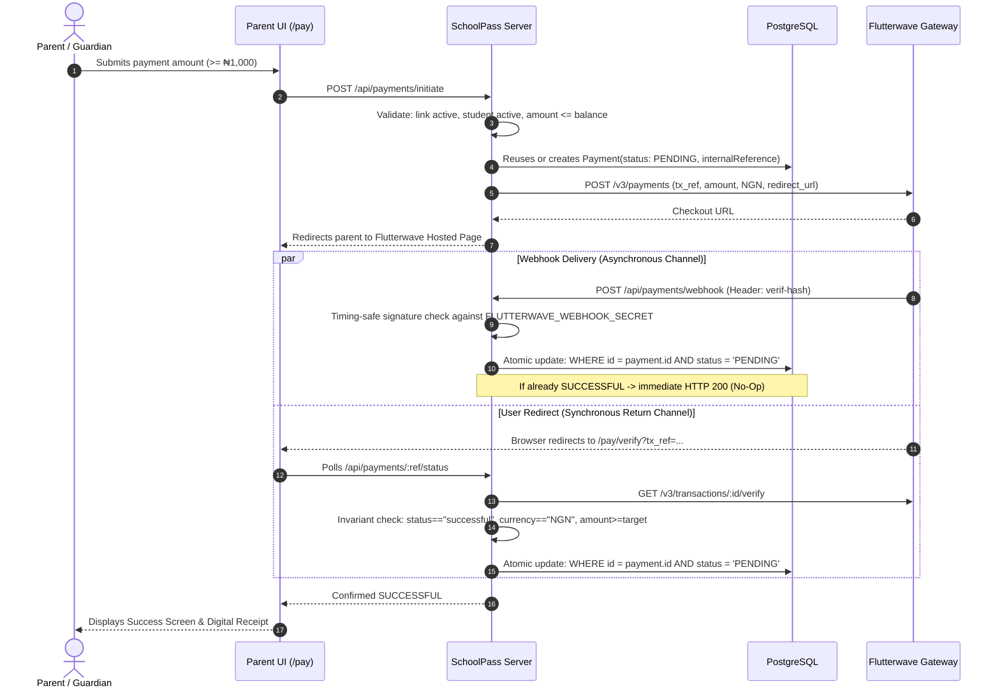
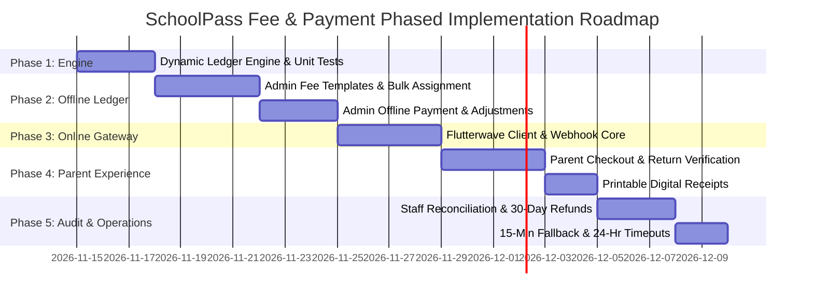

# SchoolPass Fee Management & Payments
## Final Consolidated Implementation Plan

**Document Version:** 1.0 (Consolidated)  
**Date:** 2026-11-11  
**Status:** Final Plan Pending User Approval  
**Authoritative Baselines:** [`docs/SchoolPass_PRD_v6.md`](file:///c:/Users/gbola/Desktop/SchoolPass/docs/SchoolPass_PRD_v6.md) & [`docs/PRD_ADDENDUM_v6.1.md`](file:///c:/Users/gbola/Desktop/SchoolPass/docs/PRD_ADDENDUM_v6.1.md)  
**Governing Rules:** [`RULES_PAYMENTS.md`](file:///c:/Users/gbola/Desktop/SchoolPass/.agent/rules/Payments.md), [`RULES_DATA_MODEL.md`](file:///c:/Users/gbola/Desktop/SchoolPass/.agent/rules/DataModel.md), [`RULES_PRIVACY.md`](file:///c:/Users/gbola/Desktop/SchoolPass/.agent/rules/Privacy.md), [`RULES_AUTH.md`](file:///c:/Users/gbola/Desktop/SchoolPass/.agent/rules/Auth.md), [`RULES_LOGGING.md`](file:///c:/Users/gbola/Desktop/SchoolPass/.agent/rules/Logging.md), [`RULES_CONFIG.md`](file:///c:/Users/gbola/Desktop/SchoolPass/.agent/rules/Config.md), [`RULES_STAFF_UI.md`](file:///c:/Users/gbola/Desktop/SchoolPass/.agent/rules/StaffUI.md), [`RULES_FOLDER_MAP.md`](file:///c:/Users/gbola/Desktop/SchoolPass/.agent/rules/FolderMap.md), [`RULES_RETENTION.md`](file:///c:/Users/gbola/Desktop/SchoolPass/.agent/rules/Retention.md)  
**Preceding Analysis:** [`docs/FEE_MANAGEMENT_AND_PAYMENT_WORKFLOW_PLAN.md`](file:///c:/Users/gbola/Desktop/SchoolPass/docs/FEE_MANAGEMENT_AND_PAYMENT_WORKFLOW_PLAN.md), [`docs/FEE_MANAGEMENT_AND_PAYMENT_WORKFLOW_AUDIT.md`](file:///c:/Users/gbola/Desktop/SchoolPass/docs/FEE_MANAGEMENT_AND_PAYMENT_WORKFLOW_AUDIT.md), [`docs/FEE_MANAGEMENT_AND_PAYMENT_WORKFLOW_CORRECTIONS.md`](file:///c:/Users/gbola/Desktop/SchoolPass/docs/FEE_MANAGEMENT_AND_PAYMENT_WORKFLOW_CORRECTIONS.md)

---

## 1. Executive Summary & Authoritative Alignment

This consolidated plan provides the definitive, production-grade technical blueprint for implementing school fee management and Flutterwave payments in SchoolPass.

### Consolidated Decisions Incorporated:
1. **Admin Exclusive Authority:** Only authenticated Administrators (`session.role === 'admin'`) can record, verify, and confirm offline payments (cash, bank transfers, bank deposit tellers, POS slips, etc.).
2. **Front-Desk Boundaries:** Staff with front-desk privileges (`isFrontDesk === true`) **cannot** record, approve, verify, or confirm offline payments, and cannot alter a student's balance. Front desk has **read-only student balance lookup access** to answer walk-in parent enquiries.
3. **General Staff / Teachers:** Zero payment permissions and zero access to financial ledger screens.
4. **Parent Experience:** Parents view fee obligations, term arrears breakdowns, and payment history only for verified linked children (`leftAt === null`), and initiate payments online via Flutterwave.
5. **Zero-Trust Intake Invariant:** Payment screenshots, bank alerts, or transfer notifications **never automatically reduce a balance**. Only an authorized Admin confirmation against cleared school banking records updates the ledger.
6. **Route Map Compliance:** In compliance with [`RULES_FOLDER_MAP.md`](file:///c:/Users/gbola/Desktop/SchoolPass/.agent/rules/FolderMap.md), all staff fee management, offline logging, and online transaction verification reside under [`src/app/(staff)/payments/`](file:///c:/Users/gbola/Desktop/SchoolPass/src/app/(staff)/payments/).
7. **HTML/CSS Receipts:** Clean, accessible HTML/CSS receipt views with `@media print` styling allow instant mobile and desktop printing / PDF saving without unstable server-side PDF dependencies.
8. **Pragmatic Schema Management:** Prioritizes zero unnecessary migrations while maintaining absolute financial integrity.

---

## 2. Technical Architecture & Invariant Resolutions

### 2.1 Financial Record Preservation & Cascade Deletion Audit

```
┌────────────────────────────────────────────────────────────────────────┐
│                   CRITICAL REFERENTIAL INTEGRITY AUDIT                 │
├────────────────────────────────────────────────────────────────────────┤
│ Existing in schema.prisma:                                             │
│   FeeEntry.student -> Student (onDelete: Cascade)   [HIGH RISK]        │
│   Payment.student  -> Student (onDelete: Cascade)   [HIGH RISK]        │
│   Payment.parent   -> Parent  (onDelete: Cascade)   [HIGH RISK]        │
│                                                                        │
│ Invariant: Nigerian CAMA 2020 & NDPR mandate retaining financial       │
│ records for at least 6-7 years. Deleting a Student or Parent MUST      │
│ NEVER destroy historical financial transactions.                       │
└────────────────────────────────────────────────────────────────────────┘
```

#### Resolution Strategy:
1. **Application-Level Deletion Blocker (Immediate & Zero-Migration):**
   - Every deletion action (`deleteStudentAction`, `deleteParentAction`) must query [`FeeEntry`](file:///c:/Users/gbola/Desktop/SchoolPass/prisma/schema.prisma#L266) and [`Payment`](file:///c:/Users/gbola/Desktop/SchoolPass/prisma/schema.prisma#L291) first.
   - If any financial record exists, the operation is **strictly aborted** with an error: *"Cannot delete record: Active financial ledger entries exist. Student must be marked as left (leftAt) to preserve audit compliance."*
2. **Leaver Soft-State Enforcement:**
   - In accordance with PRD Addendum §4, departed students are marked via `Student.leftAt = new Date()`.
   - The student record and all historical ledgers are preserved intact for the statutory 7-year retention period ([`RULES_RETENTION.md`](file:///c:/Users/gbola/Desktop/SchoolPass/.agent/rules/Retention.md)).
   - Parent access to that student's records terminates immediately upon `leftAt` being set.
3. **Database-Level Protection (When Schema Migration is Approved):**
   - Alter `Payment.student`, `Payment.parent`, and `FeeEntry.student` relations from `onDelete: Cascade` to `onDelete: Restrict`.

---

### 2.2 Payment Allocation & Multi-Term Balance Calculation Engine

PRD Addendum §3.1 & §3.2 mandates:
- **Unpaid fees accumulate across terms.** Debts do not reset at rollover.
- **Dynamic Ledger Formula:**
  $$\text{Outstanding Balance} = \sum(\text{CHARGE} + \text{ADJUSTMENT}) - \sum(\text{OFFLINE\_PAYMENT}) - \sum(\text{SUCCESSFUL Online Payments} - \text{CONFIRMED Refunds})$$
- Charges for terms that have not yet started are strictly excluded.

#### Dynamic FIFO Presentation Algorithm (`src/lib/payments/ledger.ts`)
Payments are not tied to individual fee items in the database; rather, the backend calculates the breakdown dynamically using FIFO (First-In, First-Out) accounting:

```typescript
export interface StudentBalanceSummary {
  studentId: string;
  totalOutstanding: Decimal;
  earlierTermsArrears: Decimal;
  currentTermBalance: Decimal;
  totalCharges: Decimal;
  totalPaid: Decimal;
  termBreakdown: Array<{
    termId: string;
    termName: string;
    charges: Decimal;
    paid: Decimal;
    outstanding: Decimal;
    isCurrentTerm: boolean;
  }>;
}
```

1. Query all `FeeEntry` records for the student where the term's start date $\le \text{now}$.
2. Query all `Payment` records with status `SUCCESSFUL` or `REFUNDED`, subtracting any `CONFIRMED` refunds.
3. Calculate aggregate `Total Paid = Total Offline Payments + Net Online Payments`.
4. Order terms chronologically ($T_1, T_2, \dots, T_k$).
5. Distribute `Total Paid` sequentially against each term's net charges:
   - Term 1 charges are covered first.
   - Any remainder covers Term 2, cascading down to Current Term ($T_k$).
6. Sum remaining balances for $T_1 \dots T_{k-1}$ as **Earlier Terms (Arrears)**.
7. Remaining balance for $T_k$ is the **Current Term Balance**.

---

### 2.3 Refund Lifecycle & Multi-Tier Auditability

In accordance with PRD v6.0 §12.15, §17, and Addendum §8.5:
- **Admin Only:** Only an Administrator can initiate a refund.
- **30-Day Constraint:** Refunds are strictly blocked if $> 30$ days have elapsed since `Payment.verifiedAt`.
- **Amount Cap:** A refund cannot exceed `Payment.amount - sum(existingConfirmedRefunds)`.
- **State Machine Integration:**
  $$\text{Payment: SUCCESSFUL} \xrightarrow[\text{Confirmed Refunds} = \text{Payment.amount}]{\text{Full Refund}} \text{Payment: REFUNDED}$$
- **Audit Logging:** Every refund initiation and resolution is recorded with structured JSON logs (`RULES_LOGGING.md`) capturing `{ actorId: admin.id, actorType: 'admin', entityId: refund.id, details: { reason, amount } }`.

---

### 2.4 Flutterwave Gateway Security, Webhook Verification & Concurrency Model



#### Security Invariants:
1. **Timing-Safe Webhook Check:**
   `crypto.timingSafeEqual(Buffer.from(headerHash), Buffer.from(secretHash))` prevents timing attacks.
2. **Server-Side Independence:**
   The frontend redirect query parameters (`status=successful`) are treated as untrusted hints. The server always calls Flutterwave's `GET /v3/transactions/:id/verify` directly.
3. **Atomic Concurrency Protection:**
   Status mutations run conditionally:
   ```typescript
   const updated = await prisma.payment.updateMany({
     where: { id: paymentId, status: 'PENDING' },
     data: { status: 'SUCCESSFUL', verifiedAt: new Date(), flutterwaveReference }
   });
   ```
   If `updated.count === 0`, another process has already finalized the transaction. Double-credits are physically impossible.
4. **15-Minute Fallback & 24-Hour Timeout:**
   - 15-minute fallback verification handles dropped connections.
   - 24-hour stuck transaction timeout transitions unresolved payments to `FAILED`.

---

### 2.5 Fee Template Validation & Protection of Historical Charges

#### Zero-Migration Architecture:
Instead of adding a new `FeeStructure` table, standard fee templates are stored as validated JSON configurations in [`SchoolSetting`](file:///c:/Users/gbola/Desktop/SchoolPass/prisma/schema.prisma#L406) under `key: "fee_templates"`.

#### Zod Schema for Fee Templates:
```typescript
export const feeTemplateSchema = z.object({
  id: z.string().cuid(),
  title: z.string().min(2).max(100),
  amount: z.string().regex(/^\d+(\.\d{1,2})?$/),
  targetClass: z.string().min(1), // e.g. "Primary 1" or "ALL"
  sessionYear: z.string().regex(/^\d{4}\/\d{4}$/), // e.g. "2026/2027"
  termId: z.string().min(1), // e.g. "2026/2027-T1"
  isCompulsory: z.boolean().default(true),
  dueDate: z.string().datetime().optional(),
});
```

#### Immutability Invariant:
When an Admin applies a template to a class:
- One individual [`FeeEntry`](file:///c:/Users/gbola/Desktop/SchoolPass/prisma/schema.prisma#L266) row of type `CHARGE` is inserted per active student.
- The `FeeEntry` stores its own fixed `amount`, `termId`, and descriptive `note`.
- **Modifying or deleting a template in `SchoolSetting` has ZERO effect on historical student charges.**
- Corrections to student charges can only be made through signed `ADJUSTMENT` entries ([`PRD_ADDENDUM_v6.1.md`](file:///c:/Users/gbola/Desktop/SchoolPass/docs/PRD_ADDENDUM_v6.1.md) §3.4).

---

### 2.6 Server-Side Role & Permission Enforcement

All permissions are strictly enforced on the server. Frontend UI elements conditionally render based on verified server claims.

```
┌────────────────────────────────────────────────────────────────────────┐
│                        AUTHORITATIVE RBAC GATES                        │
├────────────────────────────────────────────────────────────────────────┤
│ Admin Only (assertAdminSession):                                       │
│   • Configure Fee Templates                                            │
│   • Apply Bulk Charges to Class / School                               │
│   • Add Individual Student Charge                                      │
│   • Record & Confirm Offline Payment (OFFLINE_PAYMENT)                 │
│   • Post Fee Adjustment / Waiver (ADJUSTMENT)                          │
│   • Initiate Online Refund (within 30 days)                            │
│   • View Full School Financial Reports & Audit Logs                    │
│                                                                        │
│ Front Desk (session.role === 'staff' && isFrontDesk === true):         │
│   • Read-Only Student Balance Lookup (No recording, No buttons)        │
│                                                                        │
│ General Staff / Teachers (isFrontDesk === false):                      │
│   • Zero financial access (Blocked with 403 Forbidden)                 │
│                                                                        │
│ Parents (session.role === 'parent'):                                   │
│   • View fee obligations for active linked children (leftAt === null)  │
│   • Initiate online Flutterwave payments (min ₦1,000)                  │
│   • View & print digital payment receipts                              │
└────────────────────────────────────────────────────────────────────────┘
```

---

## 3. Verified Existing Capabilities vs. Proposed Future Work

| Component | Status in Codebase Today | Proposed Work in Consolidated Plan |
|---|---|---|
| **Database Models** | Verified existing in [`prisma/schema.prisma`](file:///c:/Users/gbola/Desktop/SchoolPass/prisma/schema.prisma): `FeeEntry`, `Payment`, `Refund`, `SchoolSetting`, `Student`, `Parent`, `StaffUser`. | No immediate schema migrations. Existing models used directly. |
| **Authentication & RBAC** | Verified existing in [`src/lib/auth/`](file:///c:/Users/gbola/Desktop/SchoolPass/src/lib/auth/): `getSession`, `assertAdminSession`, `assertFrontDeskAccess`. | Apply `assertAdminSession` to all financial mutation actions. |
| **Dynamic Ledger Engine** | Non-existent (`src/lib/payments/api/.gitkeep` only). | Build `src/lib/payments/ledger.ts` implementing multi-term balance math and FIFO arrears calculation. |
| **Admin Fee Management UI** | Non-existent (`src/app/(staff)/payments/.gitkeep` only). | Build tabbed Staff interface at `/payments`: Fee Templates, Bulk Assignment, Offline Confirmation, and Reconciliation. |
| **Front Desk Balance Lookup** | Non-existent. | Build read-only search tool in `/payments` for `isFrontDesk === true`, stripping all action buttons. |
| **Flutterwave API Client** | Non-existent. Keys present in `.env.example`. | Build `src/lib/payments/flutterwave.ts` with test key integration, payment initiation, and verification routines. |
| **Webhook Handler** | Non-existent (`src/app/api/payments/.gitkeep` only). | Build `src/app/api/payments/webhook/route.ts` with timing-safe signature checks and idempotent database transactions. |
| **Parent Payment Portal** | Non-existent (`src/app/(parent)/pay/.gitkeep` only). | Build `/pay` with multi-child selector, term breakdown cards, and amount selector ($\ge$ ₦1,000). |
| **Printable Receipts** | Non-existent. | Build `/pay/receipt/[reference]` with print-optimized HTML/CSS view. |

---

## 4. Phased Implementation Roadmap



---

### Phase 1: Foundation & Dynamic Ledger Calculation Engine

#### 1. What will be built:
- Core financial calculation module: `src/lib/payments/ledger.ts`.
- Pure mathematical functions:
  - `computeStudentBalance(studentId: string, asOfDate?: Date): Promise<StudentBalanceSummary>`
  - `getTermFeeBreakdown(studentId: string): Promise<TermBreakdown>`
  - `validatePaymentAmount(studentId: string, amount: Decimal): Promise<{ valid: boolean; error?: string }>`
- Application-level deletion protection:
  - Guard functions preventing deletion of students or parents with existing financial records.

#### 2. Affected Files / Modules:
- `src/lib/payments/ledger.ts` (New)
- `src/lib/payments/types.ts` (New)
- `src/lib/payments/index.ts` (New re-exports)
- `src/lib/payments/ledger.test.mjs` (New test suite)

#### 3. Security & Permission Requirements:
- Server-side only module (`import 'server-only'`).
- AI isolation: module must **never** be imported by `src/lib/ai/` ([`RULES_PRIVACY.md`](file:///c:/Users/gbola/Desktop/SchoolPass/.agent/rules/Privacy.md)).
- Parent authorization: functions verify caller's `ParentStudent` link to `studentId` before returning data.

#### 4. Database Implications:
- **Zero migrations.** Reads existing `FeeEntry`, `Payment`, and `Refund` tables using `prisma`.

#### 5. Tests & Acceptance Criteria:
- Unit tests verifying:
  - Net balance = Charges − Offline payments − Online payments.
  - Historical unpaid fees carry over accurately into earlier term arrears.
  - Unstarted future term charges are excluded from balance.
  - Negative adjustments reduce balance; positive adjustments increase balance.
  - Partial refunds increase balance by confirmed refund amount.
  - Rejection of deletion for students/parents with financial records.

---

### Phase 2: Admin Fee Templates & Bulk Assignment

#### 1. What will be built:
- Fee template management in `SchoolSetting` (`key: "fee_templates"`).
- Server actions:
  - `createFeeTemplateAction(payload)`: Admin defines reusable fee structure.
  - `applyFeeTemplateBulkAction(templateId, targetClass)`: Bulk inserts individual `FeeEntry` charges for all active students in class/school.
  - `createIndividualChargeAction(studentId, payload)`: Custom charge for exceptions.

#### 2. Affected Files / Modules:
- `src/lib/payments/templates.ts` (New)
- `src/app/(staff)/payments/actions.ts` (New)
- `src/app/(staff)/payments/FeeTemplateManager.tsx` (New component)
- `src/app/(staff)/payments/BulkAssignmentModal.tsx` (New component)

#### 3. Security & Permission Requirements:
- Every action strictly guarded by `assertAdminSession()`.
- General staff and front desk are rejected with `403 Forbidden`.
- Excludes departed students (`Student.leftAt !== null`).

#### 4. Database Implications:
- **Zero migrations.** Stores JSON in `SchoolSetting`. Bulk inserts into existing `FeeEntry` table.

#### 5. Tests & Acceptance Criteria:
- Bulk assignment generates exactly one `FeeEntry` per active student.
- Duplicate assignment prevention: re-running assignment for same template skips already-billed students.
- Non-admin callers receive unauthorized error.

---

### Phase 3: Admin Offline Payment & Adjustment Ledger

#### 1. What will be built:
- Server actions for offline financial transactions:
  - `recordOfflinePaymentAction(studentId, amount, tellerRef, note)`: Admin logs physical cash, bank transfer, or POS payment.
  - `recordAdjustmentAction(studentId, amount, note)`: Admin posts signed waiver or adjustment.
- Staff UI components at [`src/app/(staff)/payments/page.tsx`](file:///c:/Users/gbola/Desktop/SchoolPass/src/app/(staff)/payments/):
  - **Tab 1: Student Fee Directory:** Search students by name/number, display calculated balance.
  - **Tab 2: Record Offline Payment Modal:** Admin-only form requiring teller reference, amount, and note.
  - **Tab 3: Post Adjustment Modal:** Admin-only form with mandatory justification note.
  - **Front Desk Mode:** Front-desk accounts see read-only directory with action buttons removed.

#### 2. Affected Files / Modules:
- `src/app/(staff)/payments/page.tsx` (Replace `.gitkeep`)
- `src/app/(staff)/payments/PaymentsManager.tsx` (New client component)
- `src/app/(staff)/payments/OfflinePaymentModal.tsx` (New component)
- `src/app/(staff)/payments/AdjustmentModal.tsx` (New component)
- `src/app/(staff)/payments/actions.ts` (Update)

#### 3. Security & Permission Requirements:
- Strictly guarded by `assertAdminSession()`.
- Audit logging: logs every offline entry with `actorId: admin.id` without leaking sensitive balances in logs ([`RULES_LOGGING.md`](file:///c:/Users/gbola/Desktop/SchoolPass/.agent/rules/Logging.md)).

#### 4. Database Implications:
- **Zero migrations.** Commits to existing `FeeEntry` table.

#### 5. Tests & Acceptance Criteria:
- `OFFLINE_PAYMENT` requires amount > 0 and non-empty reference note.
- `ADJUSTMENT` allows negative and positive amounts with mandatory notes.
- Offline payments immediately decrement computed student balance.
- Attempt by front desk or teacher to record offline payment returns 403.

---

### Phase 4: Flutterwave Core Integration & Webhook Security

#### 1. What will be built:
- Server-side Flutterwave SDK client: `src/lib/payments/flutterwave.ts`.
- Secure endpoints:
  - `POST /api/payments/initiate`: Reuses or creates `PENDING` payment, calls Flutterwave API, returns checkout URL.
  - `POST /api/payments/webhook`: Listens for `charge.completed`, performs timing-safe signature check, updates database idempotently.
  - Active verification helper: `verifyPaymentWithFlutterwave(transactionId, internalReference)`.

#### 2. Affected Files / Modules:
- `src/lib/payments/flutterwave.ts` (New)
- `src/lib/payments/api/initiate.ts` (New logic)
- `src/lib/payments/api/webhook.ts` (New logic)
- `src/lib/payments/api/verify.ts` (New logic)
- `src/app/api/payments/initiate/route.ts` (Replace `.gitkeep` with thin re-export)
- `src/app/api/payments/webhook/route.ts` (Replace `.gitkeep` with thin re-export)

#### 3. Security & Permission Requirements:
- Initiation requires verified parent session and active `ParentStudent` link to active student (`leftAt === null`).
- Minimum amount: ₦1,000.00. Maximum amount: current student balance.
- Webhook verifies `verif-hash` header using `crypto.timingSafeEqual` against `FLUTTERWAVE_WEBHOOK_SECRET`.
- Secrets loaded exclusively on server; never exposed to browser bundles.

#### 4. Database Implications:
- **Zero migrations.** Writes to existing `Payment` table.

#### 5. Tests & Acceptance Criteria:
- Webhook signature mismatch returns HTTP 401.
- Duplicate webhook delivery returns HTTP 200 without double-crediting.
- Amount or currency mismatch (e.g. USD instead of NGN, or partial amount) transitions payment to `FAILED`.
- Concurrent initiate requests reuse existing `PENDING` payment.

---

### Phase 5: Parent Payment Portal & Printable Receipts

#### 1. What will be built:
- Parent payment interface at [`src/app/(parent)/pay/page.tsx`](file:///c:/Users/gbola/Desktop/SchoolPass/src/app/(parent)/pay/):
  - Child selector header for multi-child accounts.
  - Outstanding balance card with *Earlier Terms Arrears* vs. *Current Term* breakdown.
  - Itemized charges list (Tuition, Levies) with due dates.
  - Payment amount selector: "Pay Full Balance" vs. "Custom Amount" ($\ge$ ₦1,000).
- Payment return / verification page: `src/app/(parent)/pay/verify/page.tsx`.
- Digital payment receipt page: `src/app/(parent)/pay/receipt/[reference]/page.tsx` with print-to-PDF styles.

#### 2. Affected Files / Modules:
- `src/app/(parent)/pay/page.tsx` (Replace `.gitkeep`)
- `src/app/(parent)/pay/ParentPayManager.tsx` (New client component)
- `src/app/(parent)/pay/verify/page.tsx` (New)
- `src/app/(parent)/pay/receipt/[reference]/page.tsx` (New)
- `src/app/(parent)/pay/receipt.css` (New print styles)

#### 3. Security & Permission Requirements:
- Strictly guarded by `session.role === 'parent'`.
- Server-side check on every request: caller must have active `ParentStudent` link to requested child.
- Return page never confirms payment from URL query parameters; calls server verification action.

#### 4. Database Implications:
- **Zero migrations.** Reads `FeeEntry` and `Payment` records.

#### 5. Tests & Acceptance Criteria:
- Multi-child parents can toggle between children cleanly.
- Amounts < ₦1,000 or > balance are blocked by client and server validation.
- Return page displays verifying spinner, transitions to success modal upon confirmation.
- Printable receipt renders student number, reference, amount, school details, and verified date.

---

### Phase 6: Timeouts, Fallbacks & Admin Refunds

#### 1. What will be built:
- 15-minute fallback verification utility: polls Flutterwave for stuck `PENDING` payments.
- 24-hour timeout routine: marks `PENDING` payments older than 24 hours as `FAILED`.
- Admin refund workflow:
  - `initiateRefundAction(paymentId, amount, reason)`: Admin initiates refund via Flutterwave API.
  - Updates `Refund` record to `CONFIRMED` upon gateway confirmation.
  - Transitions `Payment.status` to `REFUNDED` if full amount refunded.
- Staff transaction reconciliation view on `/payments`: shows all Flutterwave payments with filter by status.

#### 2. Affected Files / Modules:
- `src/lib/payments/refunds.ts` (New)
- `src/lib/payments/timeouts.ts` (New)
- `src/app/(staff)/payments/ReconciliationTable.tsx` (New component)
- `src/app/(staff)/payments/RefundModal.tsx` (New component)

#### 3. Security & Permission Requirements:
- Refund action strictly guarded by `assertAdminSession()`.
- Validates refund within 30 days of `verifiedAt`.
- Enforces refund amount $\le$ original payment amount.

#### 4. Database Implications:
- **Zero migrations.** Writes to existing `Refund` table.

#### 5. Tests & Acceptance Criteria:
- Refund $> 30$ days rejected.
- Refund exceeding payment amount rejected.
- Confirmed refund automatically increases student outstanding balance.
- Stuck transaction timeout transitions payment to `FAILED`.

---

## 5. Database Schema Strategy & Migration Assessment

```
┌────────────────────────────────────────────────────────────────────────┐
│                   DEFINITIVE SCHEMA RECOMMENDATION                     │
├────────────────────────────────────────────────────────────────────────┤
│ • Zero Migrations for Phases 1 through 5:                              │
│   The existing models (FeeEntry, Payment, Refund, SchoolSetting)       │
│   support 100% of the required functionality.                          │
│                                                                        │
│ • Future Hardening Migration (Optional Phase 6):                       │
│   Change onDelete: Cascade to onDelete: Restrict on financial foreign  │
│   keys to provide database-level protection against accidental parent/ │
│   student deletion.                                                    │
└────────────────────────────────────────────────────────────────────────┘
```

The database structures in [`prisma/schema.prisma`](file:///c:/Users/gbola/Desktop/SchoolPass/prisma/schema.prisma) already provide:
- `FeeEntry`: `studentId`, `termId`, `type` (`CHARGE`, `ADJUSTMENT`, `OFFLINE_PAYMENT`), `amount`, `note`, `createdByStaffId`, `createdAt`.
- `Payment`: `studentId`, `parentId`, `amount`, `internalReference`, `flutterwaveReference`, `status`, `createdAt`, `verifiedAt`.
- `Refund`: `paymentId`, `amount`, `status`, `createdAt`.
- `SchoolSetting`: key-value store for fee templates and term dates.

**Conclusion:** We do **not** need to modify the Prisma schema or run database migrations to build the complete fee-management and online payment system.

---

## 6. Decisions Confirmed vs. Awaiting Approval

### Confirmed Decisions (Locked in Plan):
- [x] Admin exclusively records, verifies, and confirms offline payments.
- [x] Front Desk cannot record or confirm offline payments.
- [x] Front Desk has read-only student balance lookup access.
- [x] General Staff / Teachers have no financial access.
- [x] Unverified payment evidence never automatically reduces student balance.
- [x] Staff UI housed under existing route: `src/app/(staff)/payments/`.
- [x] Receipts use print-optimized HTML/CSS views.
- [x] Fee templates stored in `SchoolSetting` (Zero schema migrations).

### Decisions Awaiting Final Sign-Off:
1. **Approval to Proceed with Phase 1:**
   - Confirming authorization to implement Phase 1 (Dynamic Ledger Engine, balance math, and unit tests in `src/lib/payments/ledger.ts`).
2. **Term Identification Standard:**
   - Confirming using structured composite strings (e.g. `2026/2027-T1`, `2026/2027-T2`, `2026/2027-T3`) for indexing academic terms across `FeeEntry` and `SchoolSetting`.

---

*End of Consolidated Implementation Plan. Awaiting your approval before Phase 1 implementation begins.*

